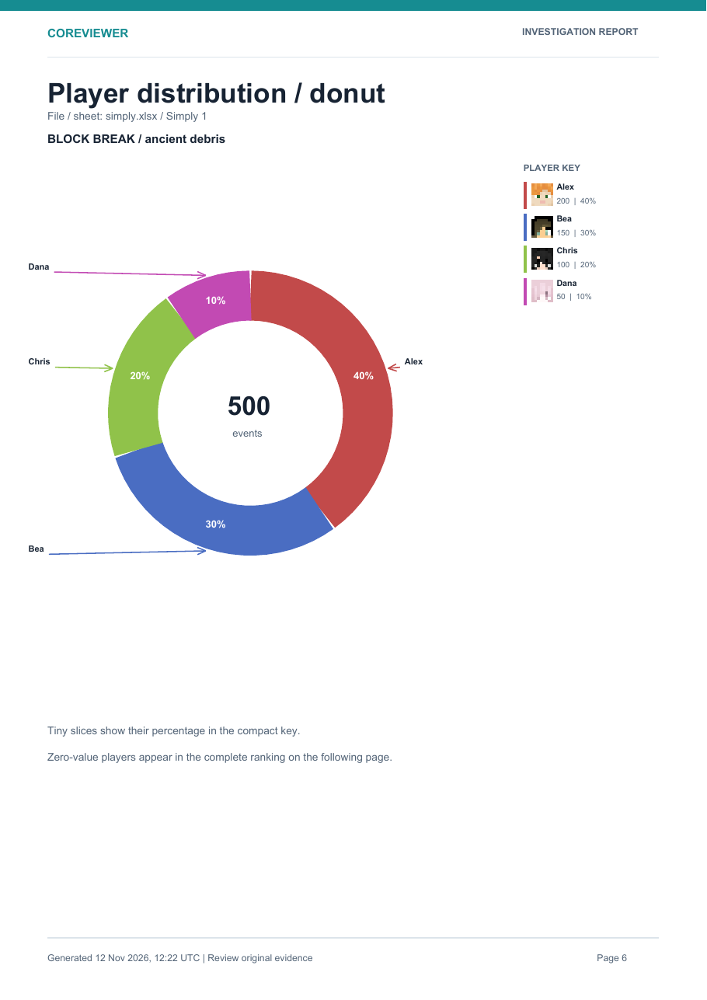
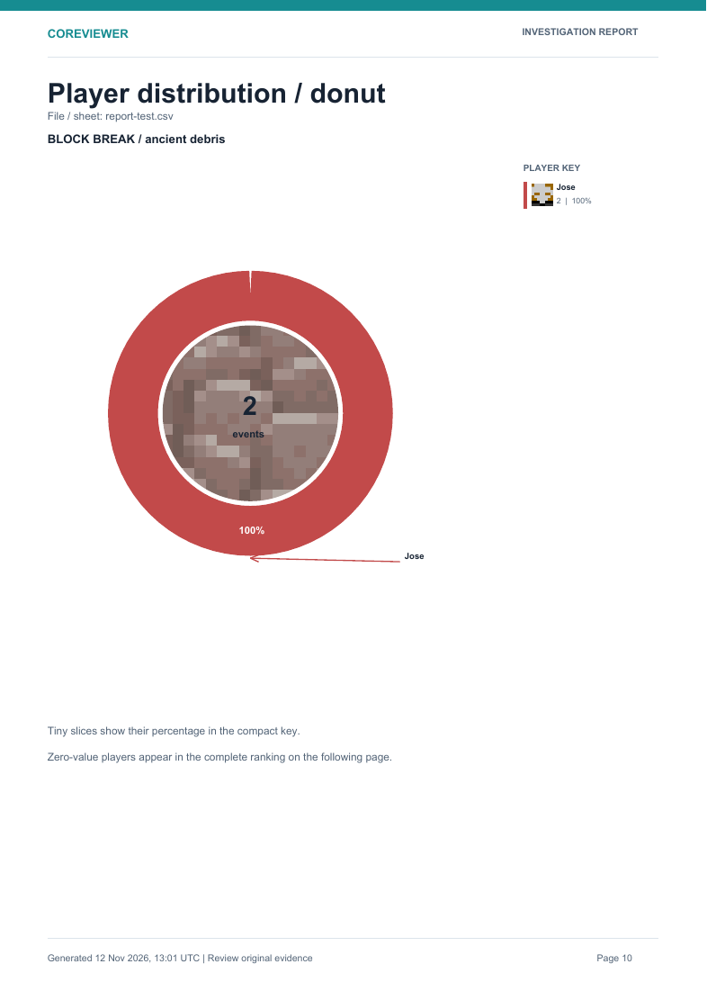

# Coreviewer investigator — 0.15.3

Client-only Fabric investigation tool for Minecraft Java **26.3**. Moderators capture English CoreProtect command responses or import CoreTrace CSVs and multi-sheet `.xlsx` workbooks, then inspect chronological static views, event replays and statistics. No SQL, server files or server-side CoreProtect API access is required. All mod text is in English.

## Quick start

1. Install the required Fabric dependencies listed below and put the Coreviewer JAR in your client's `mods` folder.
2. Join a server with CoreProtect command permission. Open **Mod Menu → Coreviewer investigator → Configure** and enable **COREVIEWER ENABLED** and **Auto Capture**.
3. Run `/co lookup r:100 t:1h` for passive capture. To fetch later pages automatically, enable **AUTO PAGE ADVANCE** before starting a lookup. Coreviewer saves supported events in its CSV library.
4. Open `/coreviewer static` for a paged world view, `/coreviewer replay` for chronological playback, or **Statistics** for a player and material breakdown. Select the matching CoreProtect world in static/replay.

To open an exported investigation, use **Settings → CSV / EXCEL → Manage Investigation Files**. Copy `.csv` files into `<game directory>/coreviewer/csv/` (subfolders are supported), or choose **Import .xlsx** for an Excel workbook.

## Guide contents

- [Installation](#installation) · [Settings](#settings) · [Capture](#capture)
- [Investigation files and imports](#investigation-files-and-imports) · [Radius and teleport](#general-radius-and-teleport)
- [Static view](#static-view) · [Replay](#replay) · [Statistics](#statistics)
- [Supported evidence and limits](#supported-evidence-and-limits) · [Files and commands](#files-and-commands)
- [Development and validation](#development-and-validation)

This README can be copied into a GitHub Wiki `Home` page. In a separate Wiki repository, relative screenshot links such as `docs/static-view.png` must be replaced with links to the main repository's `docs/` files.

## Installation

Use **JDK/Java 25**, Minecraft **26.3**, Fabric Loader **0.19.5+**, Fabric API **0.161.0+26.3**, Cloth Config **26.3.158** and optionally Mod Menu **21.0.0**. Fabric API and Cloth Config are separate installs; Excel and PDF libraries are bundled in the Coreviewer JAR. Install `Coreviewer-Investigator-0.15.3-MC26.3.jar` in the client `mods` folder.

Coreviewer uses mod ID `coreviewer`, commands `/coreviewer` and its own data directory. CoreTrace (`coretrace`) can remain installed. Enable only one automatic CoreProtect pager per investigation. The server must already provide CoreProtect and grant the required command permissions.

## Settings

Configure opens Cloth Config directly. **General → Menu Animations** controls smooth scrolling and subtle transitions. Settings have category tabs, search, reset and Save & Quit controls. The folder buttons launch the operating system file manager asynchronously. Historical block rendering supports Minecraft's Improved Transparency option in both through-wall and depth-tested modes.

## Capture

1. Open `/coreviewer config` or Mod Menu → Coreviewer → Configure.
2. Enable **COREVIEWER ENABLED** and **Auto Capture**.
3. With **AUTO PAGE ADVANCE OFF**, run `/co lookup`, `/co l` or `/co near` manually. Coreviewer captures the response without sending pagination commands.
4. With **AUTO PAGE ADVANCE ON**, run a lookup or use Dashboard → Capture → Start lookup. The scheduler reads `Page X/Y`, waits **Command Delay** (default **1500 ms**), then requests `/co l <next page>`.
5. Every capture saves automatically as `csv/<capture folder>/events.csv`. Set **Capture → Capture Folder Name** to choose the folder; blank generates a timestamp plus random ID. Repeated names receive `(2)`, `(3)`, etc., without overwriting existing investigations. Parsed batches are persisted during capture; cancelled/incomplete queries may therefore leave a partial CSV. A query containing no supported events creates no new file.
6. Successful automatic completion disables both capture switches by default. **Disable Capture After Completion** and **Notify Capture Reset** control this behavior and its message independently. Optional start/end sounds default OFF; the vanilla sound picker has search, preview and stop controls.

Capture starts only after an outgoing supported lookup command. It ignores player chat, action bars and its own feedback. One request can be outstanding; commands are delayed, unanswered pages are not retried, and errors, repeated pages, disconnects or a 30-second timeout stop the session. Chat does not contain reliable query IDs, so avoid overlapping lookups. Server system messages are not authenticated CoreProtect evidence.

## Investigation files and imports

Open **Settings → CSV / EXCEL → Open data folder**. Both CSV imports and exports use `<game directory>/coreviewer/csv/`.

Copy CSVs exported by **CoreTrace 1.4.1+26.3** into this folder or any of its subfolders. Nested CSVs are discovered recursively and listed with their relative folder paths. Open **Manage Investigation Files**, click **Refresh**, and select the files to combine. The magnifier filters filenames as you type; no Enter key is needed. Use the mouse wheel, Previous/Next buttons, or drag the vertical scrollbar to navigate matching files. Green checkboxes indicate selection. The screen includes Select all, Deselect all, up/down ordering, individual deletion, and Delete all CSVs. Deletion asks for confirmation and affects CSVs in this shared folder and its subfolders only. After deletion, empty parent folders are removed up to (but never including) the shared CSV root. After the last CSV is deleted, a folder containing only the complete CoreTrace companion set (session.json, summary.txt and transcript.log, or sesion.json, resumen.txt and transcript.log) is cleaned up too. Delete all CSVs also cleans orphaned companion sets. Folders with additional files, other CSVs or symbolic links are preserved. This applies only inside coreviewer/csv; external coretrace/exports is untouched. It does not delete external CoreTrace files or archived CSVs.

To import Excel, choose **Import .xlsx** in **Manage Investigation Files** and select a workbook. Coreviewer reads each sheet that has a compatible event header, converts it to a CSV in a new `import-<workbook>` folder and selects the imported sheets. Static view, replay and statistics then combine those events by recorded timestamp, regardless of sheet order. Unrelated sheets are ignored; the original workbook is not modified. Only modern `.xlsx` is supported, not `.xls`. Import is limited to 32 MB per workbook, 32 sheets, 200,000 rows and 40 columns per sheet. Workbook dates need an explicit timezone in the event timestamp column; Excel date-only cells cannot supply a reliable timezone. Import is unavailable in Simple Mode.

Files without server metadata are associated with the current server when first selected. Import them while connected to the intended server. Coreviewer exports retain their own server metadata. File selection/order is saved in `csv-library.json`. Reordering changes the file list and tie order, but **all selected events are sorted by recorded timestamp** for static/replay: an earlier block break precedes a later item action even when its CSV is lower in the list. Repeated Coreviewer event IDs are deduplicated; overlapping queries with distinct IDs may still overlap.

**Simple Mode** defaults OFF. Enabling it merges the currently selected events into a new capture folder and moves other existing library CSVs to `coreviewer/csv-archive/before-simple-<id>/`. The warning explains that subsequent captures replace the single active CSV; selection is unavailable in this mode. The active simple capture is replaced when the new capture first saves supported events, including a partial capture. An empty capture leaves it intact. Files copied manually into the folder while Simple Mode is ON remain unselected until the mode is disabled. Archives are never automatically deleted. `simple-csv.json` remembers the active file across restarts.

Capture saving is automatic. Imported workbook sheets and captures are stored as CSV files for selection and replay.

## General: radius and teleport

**Event Radius** accepts any positive integer; blank restores **100**. It supplies the default lookup radius and limits nearby rendering. It does not change an already executed server lookup.

**Respect Radius** defaults OFF. OFF preserves the entire selected world's timeline, including distant events. ON filters events to the radius around your position **when loading the view**, excluding outside events from pages and replay. Reload after moving the center or changing the setting. Rendering still requires loaded client chunks.

**Follow Events with Teleport** defaults OFF. When enabled, the first action of a static page or the currently reached replay action can trigger a command if outside Event Radius. It needs recorded coordinates/world and server permissions. It does not run for demo scenes, open menus, active captures, or when Respect Radius is ON. There is at most one attempt per target, spaced by at least 1500 ms or Command Delay, whichever is larger. Failed commands are not retried.

Default **Teleport Command**:

```text
/co teleport #{world} {x} {y} {z}
```

`{world}` is the exact CoreProtect world name, such as `world`, `world_nether` or `world_the_end`; `{x}`, `{y}`, `{z}` are the recorded integer coordinates. The `#` belongs to the default command template. Separate arguments with spaces. A server-specific example is `/tp {world} {x} {y} {z}` **only if that server's teleport command supports a world argument**. Vanilla `/tp @s {x} {y} {z}` works within the current dimension. Unresolved placeholders or multiline templates are rejected. A dimension change shortly after a Coreviewer teleport preserves the view; disconnects and unrelated world changes end it.

## Static view

Open `/coreviewer static` (**G**). Select a CoreProtect world and **Show selected world** to bind its records to the current client dimension. Check that the dimension matches: server world names cannot reliably be inferred from client dimension IDs. Each view is a snapshot of the selected CSVs for the current server and chosen world. Load again after adding captures or changing files.

- **V/B**: previous/next chronological page. Default **Maximum Visible Events: 10**. Page progress is centered above health, yellow for 10 seconds by default; color, duration and visibility are configurable.
- **Block View**: transparent default block models, outlines, colors, opacity and optional texture tint.
- **Click View**: a ghost of the clicked block at its recorded position, including chest and ender chest item-model fallbacks, with its own color and the same page, replay, label, radius and arrow behavior as other positioned events.
- **Kill View**: player deaths use a custom stone memorial with the victim's head and two vanilla flowers; mob deaths retain frozen display figures. Victim/killer/cause labels remain available. Missing causes stay unknown.
- **Item View**: floating item models and quantities; optional generic player-head holograms.
- **Container View**: chest-style inventory slots with green added/red removed backgrounds, item models, quantities and actor names.
- **Session View**: frozen player holograms using available current skins and green/red login/logout borders.
- **Arrows**: chronological links across visible supported event categories, per player by default. Configure color, size and animation speed. Equal or approximate timestamps do not establish a definite order and are not linked.

**Show Server Time** defaults ON in STATIC VIEW and also applies to replay. Labels show the recorded event time normalized to UTC, `~` for approximate chat times, or Unknown when unavailable. It can be switched off independently of ordinary event labels.

Category toggles also apply to replay. Through-wall mode applies to block overlays, labels, markers and arrows; inventory-slot backgrounds and vanilla item/entity models retain world occlusion. Session skins and grave portraits use available server profiles or vanilla asynchronous UUID/name lookup; failed lookups use a default skin. These are current skins, not historical skins. Orientations, item metadata and movement are not reconstructed. Missing coordinates or timestamps cannot produce a chronological world marker. Type toggles, loaded chunks and rendering radius may reduce the visible subset of a page without replacing it with later actions.

## Replay

Open `/coreviewer replay` (**H**), choose a world and **Load world**. **Play in world** starts playback; opening a regular menu or losing focus pauses it. The in-world control bar keeps playback running while its cursor is active. Replay uses original event timestamps and never edits real terrain or entities.

| Default key | Action |
| --- | --- |
| Right Shift | Play / pause in the current direction |
| R | Play reverse / pause reverse playback |
| U | Show / hide the in-world control cursor |
| Comma | Forward to next timestamp |
| Period | Backward to previous timestamp |
| J | Start / load selected world |
| K | Restart paused |
| L | Stop and hide |
| H | Replay menu |

All keys are configurable in REPLAY settings. They apply in the world and while the replay control cursor is open; active shortcuts take priority over vanilla bindings. A slider supports seeking, and equal-time actions appear together.

The in-world control bar sits beneath the upper-left replay status. Press **U** to use its buttons: Restart paused, Previous event, Play reverse, Play / Pause, Play forward, Next event, Stop replay and Hide cursor. Hover for tooltips. **U** or **Esc** returns control to the camera. While the cursor is visible, drag the **Drag replay controls** grip to place the bar anywhere on screen. Its position is saved automatically and adjusted to stay on screen when the resolution changes. **Replay Button Scale** in REPLAY settings resizes every button and the grip together (75%-150%; default 100%). While the cursor is open, clicks operate the interface instead of interacting with blocks. Other menus still pause playback.

**Reverse playback** moves continuously backward through recorded time. Press **R** to start it, or pause it when already reversing. Right Shift resumes the current direction; the Play forward button switches to forward playback. Reversing from the beginning starts at the end. Playback pauses automatically at the beginning. Restart returns to the beginning paused in the forward direction. The rolling visible-event window updates in both directions and equal-time events leave together. Smart Timeline also compresses reverse idle gaps while preserving time for the preceding event's animation. Arrows continue to represent historical chronological order, not playback direction.

**Maximum Visible Events** defaults to **10** (blank/reset also use 10). The rolling window removes the oldest action when a new one exceeds the limit; rewind restores the corresponding earlier window. Progress shows reached/total and window size above health, separately from static progress. It hides at completion/stop or after the configurable pause timeout (default 10 seconds). Color and visibility are configurable.

**Smart Timeline** defaults ON. The **Smart Timeline (seconds)** text field is near the top of REPLAY settings, with an adjacent **ON/OFF** button. It defaults to **2** seconds and accepts nonnegative numbers, including decimals; clearing the field restores 2. Existing saved values are preserved until edited or reset. Long idle gaps are compressed after the configured wait and completion of the preceding block animation. Timeline Speed scales this wait along with historical time. Zero skips idle gaps as soon as animations allow. Disable Smart Timeline to preserve idle time. Block Break Speed, Block Place Speed and Timeline Speed support 0.25×, 0.5×, 1×, 2× and 4×.

Replay reconstructs logged actions, not walking paths or an authoritative historical world. Approximate timestamps are marked `~`. Optional Follow Events with Teleport is the only replay navigation feature that sends a server command.

## Statistics

Open **Settings → STATISTICS → Open Statistics**, or **Statistics** on the dashboard. Statistics use all selected CSV/Excel files, independently of the view's radius and world binding.

The category dropdown contains **All**, **Blocks**, **Clicks**, **Items**, **Containers**, **Kills**, **Sessions**. Clicks have their own columns with clicked-block icons and counts; click a player and then a block icon to inspect individual click coordinates. Compact headers have neutral backgrounds. Separate action columns use soft green for additions/placements/logins and soft red for removals/breaks/logouts. Header corner icons identify blocks, clicks, items, containers, kills and sessions. **Compact** defaults ON: opposing actions for the same material and category share one column, with green additions / red removals (for example, `10 / 5`). Different categories are never merged into one unit. Turn Compact OFF for separate action columns. **Show details** hides or shows header names while preserving icons and tooltips. Both preferences are saved. Horizontal arrows browse columns while the player column stays fixed. The magnifier **Item** search filters matching material/action columns; **Player** search jumps to the first matching player row (exact names have priority). **↑ Previous / ↓ Next**, the mouse wheel and Up/Down keys page through players. Left/Right keys and horizontal mouse scrolling browse columns. The four arrow keys browse the table even after a text field was selected. Enter or a click outside the text fields clears their focus. Drag the horizontal and vertical scrollbars to navigate larger tables.

Rows default to player A–Z. Each column arrow cycles highest count first → lowest first → player A–Z. **Sort: ADDED / REMOVED / TOTAL** chooses which number to rank in compact columns. Alphabetical ties are deterministic. **Reset filters** clears searches, category and sorting; sorting is not saved when the statistics screen is closed.

Click a player head or name to inspect their categories, then click a material icon in the personal table to open individual events with quantities, UTC times, worlds and exact recorded coordinates. The evidence screen reads the same snapshot as the table, runs scans off-thread and retains only its current page (at most 20 records); missing coordinates remain unavailable. Escape, Back and All players return one level at a time, preserving the previous table and its searches, sorting and page. The wheel and Up/Down keys also work in individual evidence pages. Heads resolve current skins asynchronously from available online profiles, recorded UUIDs or valid player names. Missing/unresolvable profiles retain a generic head; these are current skins, not historical recordings.

The **TOTAL** row sums every player in the current category/filter, not just the visible page. Block, kill and session columns count events. Item/container columns sum known quantities, keeping additions and removals separate. Unknown quantities are excluded from numeric sums and reported separately. The footer reports event count; All does not combine incompatible units into one misleading number.

### Statistics teleport tour

**TP Mode** defaults OFF. Enable it to show player checkboxes, material/action checkboxes and **TP Now**. All players and actions start selected. **Players** and **Actions** toggle the complete current category selection, including off-screen pages. In Compact mode, additions and removals have independent small green/red checkboxes. Separate columns have their own checkbox. The same controls are available inside a player's summary. Item search changes which columns you see; it does not silently deselect hidden columns.

**Radius** defaults to `0`; an empty field also means `0` and keeps every matching event. Enter any finite nonnegative number of blocks, including decimals. A positive radius reduces nearby stops by checking events newest first against the **last retained** location for the same player, world, category, material and action. Older events within that 3D distance are skipped. Each retained older event becomes the next comparison point. Overworld, Nether and End remain separate, as do block placement/breaking, item drops and container actions. The zone count refreshes 0.5 seconds after typing stops, on a background worker, without pressing Enter. The table retains its original totals. When Radius is positive, each cell also shows the retained stop count with an ender pearl; hover the pearl for its meaning. With zero or blank radius, the extra count is hidden. This filter does not alter source files.

**TP Now** opens a world-visible preview with the actor's head beside their name, coordinates and event details. It does **not** teleport on opening. Movement is available by default. Press the configurable **TP Movement Lock Key** (U by default) to lock movement and show clickable controls; press it again to resume movement. The small arrow before the head/name opens a searchable player list while controls are visible. Choosing a player previews that player's first stop; only a subsequent **Next** sends the teleport command. **Next** visits the first stop; **Back** revisits the previous stop. They use the Static View Next/Previous keys (B/V by default) while **Linked TP Mode Keys** is ON. Turn it OFF in Static View settings and reopen the editor to assign independent keys. Escape exits the tour. The current keys and the movement instruction appear below the buttons. The route visits all stops for one player in time order, then the next player's stops; player groups are ordered by their earliest retained event. Each Back/Next visit sends exactly one `/co teleport #{world} {x} {y} {z}` request using the recorded world and coordinates. Server CoreProtect permissions still apply; a request is not confirmation that the server accepted the teleport. The tour excludes simulated records, missing timestamps/coordinates and unusable world names. Recorded server labels are ignored when selecting stops. The tour has no automatic command scheduler and stops issuing commands if Coreviewer is disabled or the connection closes.

### PDF investigation reports

Open **Settings → STATISTICS → Create Report**. The report builder uses the investigation files currently selected in **CSV / EXCEL → Manage Investigation Files**; imported workbook sheets appear through their selected converted CSV files. Search and check players and event materials separately. Player heads load in the background beside names as soon as the builder opens; unresolved players show an initial. **All players / None** and **All shown / None shown** act on the current search/category results. The category row filters the event-material list; it does not silently change selections in hidden categories. Every selected player appears in the PDF, including a player with zero matching events. Unselected players are excluded.

Select any combination of **Player bars**, **Stacked categories**, **Category donut**, and **Activity timeline**. The **Sort** control chooses name or an event count (breaks, places, item quantities, container quantities, kills, sessions, clicks or all events); the adjacent arrow switches ascending and descending order. A count sort starts with the highest first. The chosen player order applies to the summary table and player charts and is recorded in the PDF.

**Breakdown...** opens the optional report-section menu. All its options start OFF. Check any observed action/material pair to add a separate section (for example, ancient debris broken and ancient debris placed are different sections). **Split by file** adds an independent overview for each selected CSV or imported XLSX workbook. **Split by sheet** adds an overview for each worksheet and automatically enables file splitting. CSV files have no sheets. When both are enabled, the report contains a workbook overview and separate worksheet overviews; selected action/material sections are created inside the corresponding worksheets. A workbook split without sheet splitting combines its selected worksheets. New XLSX imports preserve the original workbook and sheet names in the CSV library metadata; older imports use their stored import folder and sheet CSV filenames. The planner rejects more than 300 extra sections with a clear message so large selections cannot silently exhaust memory.

Each action/material bar section shows total, mean across all selected players (including zero), mean among players with a positive known value, median and maximum. A vertical dotted line marks the all-player mean. Block, kill, session and click values count actions; item and container values sum known item quantities. Unknown quantities are listed separately and never treated as zero. The action/material title and vanilla texture chip have soft red backgrounds for break/remove/logout and soft green for place/add/login. When one block material is selected, the global block-bar chart also shows separate red and green material chips. The player summary hides categories absent from the selected evidence; it keeps selected players with zero matches.

The optional action/material donut divides the recorded total by player. Zero-value players receive no donut color, though they remain in the full ranking. Up to 12 positive players have individual slices; from 13 onward, the 12 largest are shown with one **Others** slice and a complete per-player ranking on following pages. Player colors remain stable across sections. Outside labels point to each slice; percentages appear inside slices that have room and in the compact right-hand key for every slice. If every event in a donut concerns the same block, its vanilla texture appears only inside the hole at 70% opacity behind the total. Mixed or non-block donuts keep a plain center. A zero-total action/material section has no donut. Source overviews count recorded actions and label this unit explicitly; action/material pages are where item and container quantities are compared.





**Create PDF** saves a timestamped file in `<game directory>/coreviewer/reports/`; **Open reports folder** opens that directory. The on-screen saved-file notice clears after 30 seconds. Generation and current-skin retrieval run in the background. The report queries Mojang for each player's current UUID by the original name, including underscores; a recorded UUID is used if that lookup is unavailable. Transient service failures are retried. Mojang's texture URL is upgraded to HTTPS. Names that are unavailable to Mojang, network failures and rate limits use an initial avatar. These are current skins, not historical skins. The report includes the selected source-file list, material filters and export time. It is a summary, with no per-event appendix. Its charts are investigative leads, not proof of misconduct.

## Supported evidence and limits

CoreTrace CSV import supports schema 2 block break/place/click, item pickup/drop, container add/remove, kills, sessions, and available ender-chest/projectile item records. Inventory, chat, command, username, sign and unsupported actions are skipped and counted. CSV parsing supports UTF-8 BOM, optional `sep=,`, quoted commas/newlines and reordered header columns. Compatible sheets in `.xlsx` workbooks use the same event parser after import.

English chat supports broke/placed/clicked, killed, added/removed (container), picked up/dropped/withdrew/deposited/threw/shot, and logged in/out. Coordinates come from visible `(x…/y…/z…/world)` lines. Hover timestamps are preferred; relative chat ages are marked approximate. CSV timestamps must contain a timezone or ISO offset; unavailable/invalid times remain unknown and are excluded from timelines but retained for statistics. Missing UUIDs, causes, coordinates and quantities are never fabricated. Quantity zero internally means unknown and exports as blank.

Plain-text mob/player names can be ambiguous. Entity registry matches are treated as mobs; unknown unnamespaced names as players. This cannot prove whether a player named `zombie` is a mob. Demo data is labeled and excluded from real world timelines; do not select simulated CSVs for evidentiary statistics.

## Files and commands

```text
coreviewer/
  config.json
  config.json.bak
  simple-csv.json              # active Simple Mode file, when used
  csv-library.json
  csv/                         # shared imports, including nested folders
    <capture folder>/events.csv # automatically saved capture
  csv-archive/                 # files archived when Simple Mode is enabled
  reports/                     # generated PDF summaries
```

`/coreviewer` opens the dashboard. Additional commands: `config`, `lookup [parameters]`, `stop` (capture), `status`, `static`, `replay`, `simulate`, `save` (automatic-saving status), `reload` (CSV library), and `clear` (delete active library CSVs). `/coreviewer clear` executes immediately; the library screen offers confirmation dialogs. No command deletes external source exports or the archive.

Master OFF stops capture, command scheduling and overlays while preserving settings. Already-started disk operations may finish; registered callbacks and existing data still occupy memory.

## Development and validation

Build with JDK 25 and the included Gradle 9.6 wrapper / Fabric Loom 1.17:

```powershell
.\gradlew.bat build
.\gradlew.bat runClientGameTest
.\gradlew.bat runClient
```

For a focused client scenario, use `./gradlew runClientGameTest "-PcoreviewerTestClass=dev.coreviewer.LibraryGameTest"`. Omit that property to run all seven scenarios.

Linux/macOS: `sh gradlew build`. Install the regular JAR in `build/libs`, not `-sources.jar`. The GitHub Actions workflow builds/tests source pushes and provides an artifact. See [release notes](GITHUB_RELEASE.md).

Parsing, disk writes, statistics aggregation and index construction run off the Minecraft thread. Scene selection uses immutable indexes and a bounded background queue; only loaded chunks are considered. Model caches and figure limits bound rendering work. CSV parsing reuses up to eight unchanged files / 200,000 cached events; selected history itself is not silently truncated. Large user-selected display limits still cost rendering time.

Tests cover configuration, capture scheduling, CSV compatibility with the supplied CoreTrace 1.4.1 fixture, escaping, unknown metadata, selection persistence, chronology, Simple Mode, statistics, replay and spatial indexing. Isolated Minecraft client scenarios exercise configuration, capture, rendering, replay controls, library selection, statistics, container/session models, radius filtering and a permitted teleport. These are local simulated tests, not validation against a live CoreProtect server.

Version 0.15.3 verification: unit tests cover report file/sheet provenance, action/material sections, known item quantities, all-player and active-player means, zero-value players, 12-player donut grouping, player-name preservation, report sorting, PDF export and 70% block-texture opacity. A generated PDF was rendered and visually checked. Live Mojang lookups resolved downloadable skin faces for `Frecciatore` and `Juno_72`. The isolated Minecraft client test opened the report builder, displayed a real `Frecciatore` head without the blue overlay, selected a breakdown and generated a PDF using vanilla ancient-debris texture. Live CoreProtect server acceptance remains unverified.

Screenshots: [Radius and zones](docs/statistics-radius-zones.png), [TP selection](docs/statistics-tp-selection.png), [TP preview](docs/statistics-tp-preview.png), [replay toolbar](docs/replay-toolbar.png), [direct settings](docs/direct-settings.png), [player memorial](docs/player-memorial.png), [container slot](docs/container-slot.png), [search and sorting](docs/statistics-search-sort.png), [individual evidence](docs/statistics-evidence.png), [category dropdown](docs/statistics-dropdown.png), [Smart Timeline input](docs/smart-timeline.png), [icon-only statistics](docs/statistics-icons-only.png), [CSV library](docs/csv-library.png), [statistics](docs/statistics-all.png), [player statistics](docs/statistics-player.png), [containers and sessions](docs/container-sessions.png).


### Import Coretracer exports

When the `coretrace` Fabric mod is loaded, Investigation Files shows **Import Coretracer** beside **Open data folder**. The selector scans `coretrace/exports` recursively for `.csv` and `.xlsx`, filters filenames while typing, and keeps checkbox selections across pages. Use the mouse wheel, Previous/Next buttons, or drag the vertical scrollbar to navigate results. Select all/Deselect all apply to the current search results. Import selected copies CSV exports into distinct Coreviewer folders and imports compatible Excel sheets through the workbook importer. Original exports remain intact. Disable Simple Mode to use this importer.
